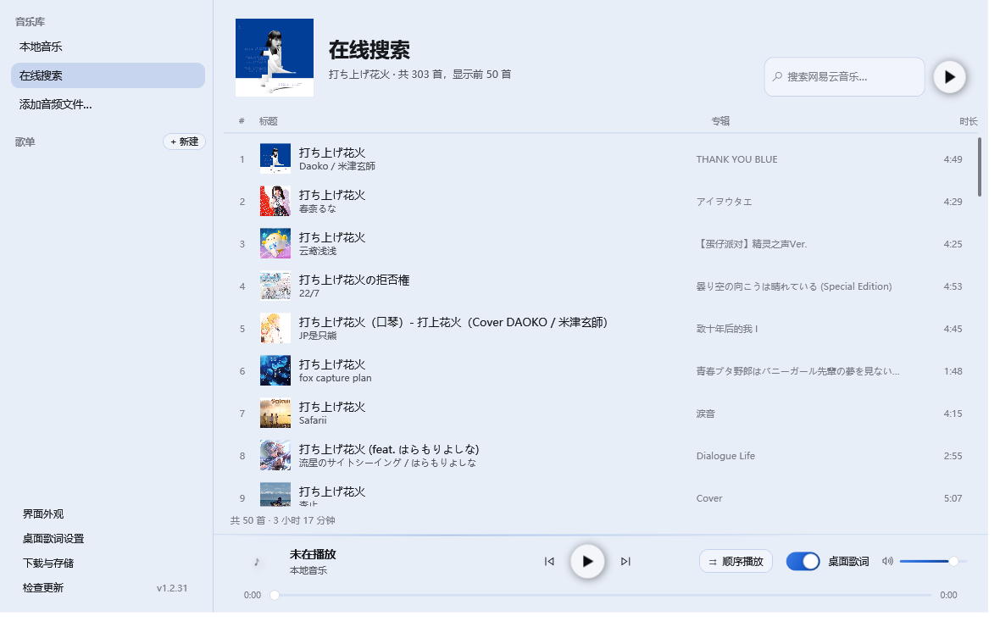
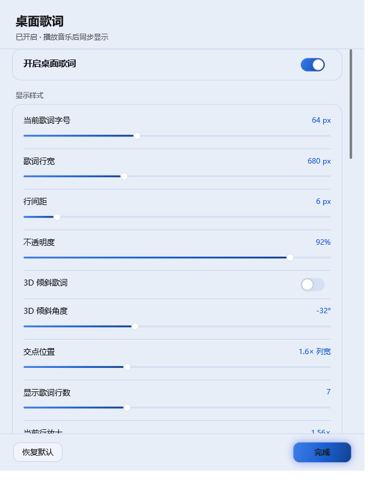
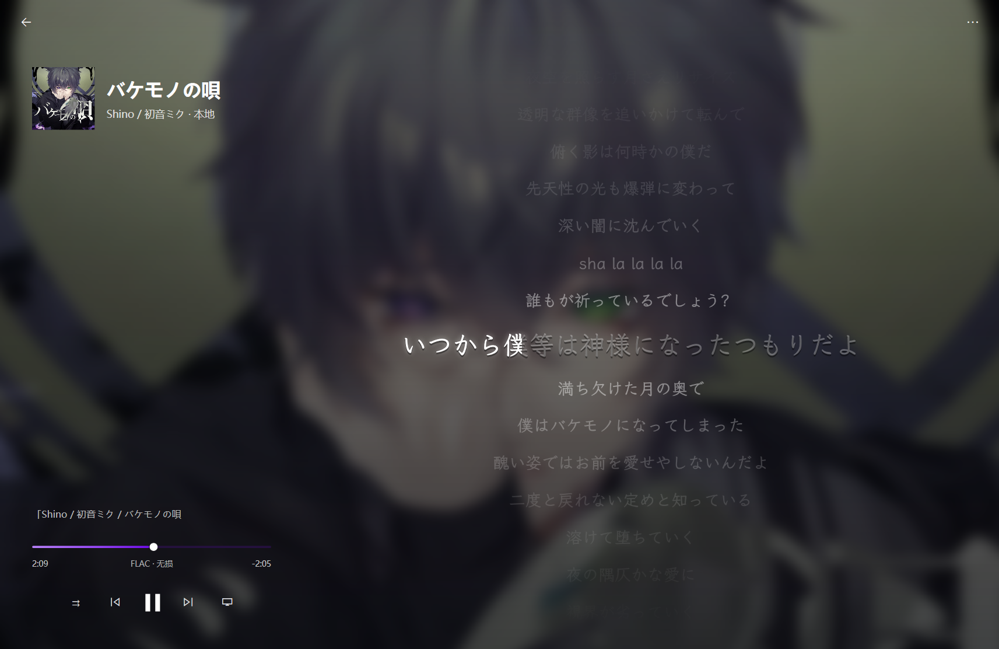

# Darius Music

Windows 桌面音乐播放器 + 桌面歌词。WPF / .NET 10，无安装器、无运行时依赖注入；一个 exe 起一个进程，歌词逐字上色、延时辉光、3D 倾斜。

> A Windows music player with a desktop lyric overlay, written in WPF on .NET 10. Docs are in Chinese; code comments explain the why, not the what.



| 桌面歌词 | 设置 |
|---|---|
|  |  |

| 播放页 · 浅色封面 | 播放页 · 深色封面 |
|---|---|
|  |  |

## 能做什么

- **曲库**：扫描本地文件夹（`mp3 / flac / m4a / aac / wav / ogg / wma`），也支持手动逐个添加；读 ID3v2 / FLAC / Ogg / MP4 标签与内嵌封面。
- **在线**：网易云搜索、试听、下载（含歌词与封面）；可粘贴自己的 `MUSIC_U` Cookie 提高音质与可播范围；支持落雪（LX）脚本作为额外音源。
- **歌词**：同名 `.lrc` 自动加载，行时间 `[mm:ss.xx]`、逐字 `<mm:ss.xx>`、双语合并、每首独立偏移；没有逐字时间时按字均分。
- **桌面歌词**：透明置顶窗口，多行歌词、当前句放大、邻句淡出、换句滚动；逐字上色 + 延音辉光（颜色/强度/范围可调）；3D 倾斜（透视投影，不是旋转）；背景可以是封面霜化、图片、纯色或透明；边缘羽化，长句不会被窗口边缘硬切。
- **播放页**：全屏/宽屏两套排版，歌词区与桌面歌词各自独立一套参数。
- **主题**：整窗配色由「主色 + 背景色」推导（浅色浅字深字、深色自动反相），背景可以是当前封面。
- **更新**：版本目录布局（`versions\vX` + `current.txt`），下载新版本时从不覆盖正在运行的文件；清单可签名（HMAC-SHA256），验签失败拒绝安装。
- **杂项**：歌单、拖拽排序、单曲删除（6 秒撤销）、WSA 播放队列导入（adb）、音量混音器记忆。单击一行播放，再点当前行暂停。

## 运行

要求：**Windows 10 1809+ / Windows 11**，**.NET 10 桌面运行时**（开发需要 .NET 10 SDK）。

```powershell
git clone <this repo> DariusMusic
cd DariusMusic
dotnet build
# 产物：bin\Debug\net10.0-windows10.0.19041.0\Darius Music.exe
```

不想自己编译就下现成的：[**Releases**](https://github.com/tuoersuo231/Darius-Music/releases) 里有 `DariusMusic-<版本>-win-x64.zip`，解压即用 —— 和内置更新源发布的是同一个包（哈希一致）。

单文件式发布（framework-dependent，约 52 MB）：

```powershell
dotnet publish -c Release -r win-x64 --self-contained false -o out
```

### 数据放哪

默认在**安装根目录**的 `data\`（不是 `%APPDATA%`），换版本不会丢；也可以用环境变量 `DARIUS_DATA_DIR` 指到别处：

| 文件 | 内容 |
|---|---|
| `settings.json` | 全部设置：曲库、主题、歌词参数、每首歌的歌词偏移、网易云 Cookie |
| `playlists.json` | 歌单 |
| `covers\` `lyrics\` `stream\` `downloads\` | 封面、歌词、流式缓存、下载中转 |

删掉 `data\` 就回到默认设置。

### 安装布局

```
Darius Music\
  Darius Music.exe      启动器（读 current.txt，起对应版本）
  current.txt           v1.2.31
  config.json           keepVersions / hmacKey（清单签名密钥，自行生成）
  versions\v1.2.31\     程序本体
  data\                 用户数据（跨版本共享）
```

只跑 `versions\vX\Darius Music.exe` 也能用（数据仍落在根目录）。

## 更新源（可选）

程序支持「目录 / 共享目录 / http」三种更新源，按顺序尝试：

1. 设置里手填的地址（最高优先级）
2. 安装根目录或 exe 旁边的 `update-feed.txt`（一行一个地址，`#` 开头是注释）
3. 编译时烘进程序集的默认值：`dotnet publish -p:UpdateFeedDefault=https://example.com/feed`

清单就是一个 `latest.json`：

```json
{
  "version": "1.2.31",
  "v": 10231,
  "notes": "更新说明，会显示在更新提示里",
  "package": "DariusMusic-1.2.31-win-x64.zip",
  "sha256": "…",
  "size": 21076763,
  "sig": "…",
  "url": "https://example.com/feed/DariusMusic-1.2.31-win-x64.zip"
}
```

`package` 是一个**平铺**的 zip（根目录就是 `Darius Music.exe` 那一层）。`sig` 是对 `v|sha256`（sha 小写）做的 HMAC-SHA256，密钥来自安装根目录 `config.json` 的 `hmacKey`（base64 或 hex）；没有 `sig` 时只校验 SHA256。实现见 `Services/UpdateService.cs`、`Services/VersionStore.cs`。

> 仓库里**不含**任何密钥或更新地址，`config.json` 也不在仓库里 —— 自己部署时请生成自己的 `hmacKey`，别把私钥提交上去。

## 自检 / 调试

`Program.cs` 里带一套无界面的自检命令（截图、播放、歌词、UI、更新链都能单独跑），例如：

```powershell
& ".\Darius Music.exe" --shot out.png --pos 23900     # 把桌面歌词渲染成 PNG
& ".\Darius Music.exe" --ui-shot shots --folder D:\Music
& ".\Darius Music.exe" --update-check https://example.com/feed
```

完整清单见 [`docs/开发说明.md`](docs/开发说明.md)。

## 结构

```
CurrentLyrics.csproj   WPF 工程（net10.0-windows10.0.19041.0，为了 WinRT MediaPlayer）
Program.cs             入口 + 全部自检命令
Theme.xaml             控件样式与调色板
Models/                Song / LyricLine / LyricWord
Services/              播放、曲库、歌词解析、网易云、下载、更新、设置
Controls/              歌词列渲染、逐字时序、辉光位图、透视、只在拖动时改值的滑杆
Views/                 主窗口、播放页、桌面歌词、设置、界面外观、调色板
Fonts/                 霞鹜文楷（OFL-1.1）
```

## 第三方

- 霞鹜文楷 LXGW WenKai —— SIL Open Font License 1.1（`Fonts/OFL.txt`）
- [Jint](https://github.com/sebastienros/jint) —— MIT，用于执行落雪（LX）脚本

## 免责声明

这是一个个人自用的播放器，**与网易云音乐无关联**，也未获其授权。在线功能走的是公开接口，仅供个人学习与自用；请遵守平台服务条款，不要传播下载到的音频。仓库里不含任何音乐文件、歌词或封面。
